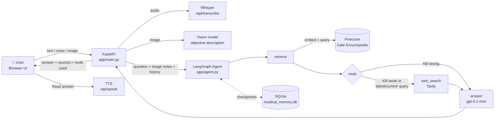
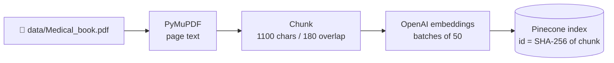

# ✚ MedGuide AI — Medical Agentic Chatbot

An agentic, multimodal **medical education and triage assistant** built with **LangGraph**, **FastAPI**, **Pinecone**, **Tavily** and **OpenAI**.

MedGuide AI answers health questions by retrieving passages from a medical reference book (RAG over Pinecone), deciding on its own whether it also needs fresh information from the web (Tavily), and then composing a cautious, cited answer. Users can type, **speak** (Whisper speech-to-text), **upload or capture a photo** (GPT vision), and have the answer **read aloud** (text-to-speech) — all from a lightweight browser UI.

> ⚠️ **Disclaimer:** This project is for **educational purposes only**. It is not a medical device, does not provide diagnoses, and is not a substitute for a licensed clinician. In an emergency, contact your local emergency services immediately.


---

## 📑 Table of Contents

- [Key Features](#-key-features)
- [Tech Stack](#-tech-stack)
- [Architecture](#-architecture)
- [How the Agent Works](#-how-the-agent-works)
- [Safety Guardrails](#-safety-guardrails)
- [Project Structure](#-project-structure)
- [Getting Started](#-getting-started)
- [Configuration](#-configuration)
- [Ingesting the Knowledge Base](#-ingesting-the-knowledge-base)
- [Running the App](#-running-the-app)
- [API Reference](#-api-reference)
- [Testing the Agent](#-testing-the-agent)
- [Troubleshooting](#-troubleshooting)
- [Known Limitations](#-known-limitations)
- [Roadmap](#-roadmap)
- [License](#-license)
- [Author](#-author)

---

## ✨ Key Features

| Feature | Description |
|---|---|
| 🧠 **Agentic workflow (LangGraph)** | A `StateGraph` with retrieve → route → (web search) → answer nodes. The agent decides at runtime whether the knowledge base is enough or whether it needs to search the web. |
| 📚 **RAG over a medical book** | *The Gale Encyclopedia of Medicine* (2002) is chunked, embedded with `text-embedding-3-small`, and stored in a **Pinecone** serverless index. |
| 🌐 **Live web research** | When the knowledge base is weak, or the question asks for current information, the agent queries **Tavily** for up-to-date clinical guidance. |
| 🖼️ **Image understanding** | Upload a photo or capture one from the camera. A vision model describes *only objectively visible features* — it never diagnoses from the image. |
| 🎤 **Voice input** | Record a question in the browser; it's transcribed with OpenAI **Whisper**. |
| 🔊 **Voice output** | Have the latest answer read aloud with OpenAI **TTS** (`tts-1`, voice `alloy`). |
| 📎 **Source citations** | Answers cite `[PDF p.N]` for book passages and URLs for web results; the UI lists the sources under each reply. |
| 💾 **Persistent agent state** | LangGraph checkpoints are stored in SQLite (`medical_memory.db`) per conversation thread via `SqliteSaver`. |
| 🛡️ **Safety-first prompting** | No confirmed diagnoses, no prescriptions or dosages, emergency escalation, uncertainty stated explicitly. |
| 🔐 **Optional API token auth** | Protect every endpoint with a Bearer token, compared in constant time. |

---

## 🧰 Tech Stack

| Layer | Technology |
|---|---|
| Agent orchestration | [LangGraph](https://github.com/langchain-ai/langgraph) (`StateGraph`, `SqliteSaver` checkpointer) |
| LLM | OpenAI `gpt-4.1-mini` via `langchain-openai` (temperature 0.1) |
| Embeddings | OpenAI `text-embedding-3-small` (1536-dim) |
| Vector database | [Pinecone](https://www.pinecone.io/) serverless (AWS `us-east-1`, cosine) |
| Web search | [Tavily](https://tavily.com/) |
| Vision | OpenAI `gpt-4.1-mini` (image input) |
| Speech-to-text | OpenAI `whisper-1` |
| Text-to-speech | OpenAI `tts-1` |
| Backend | FastAPI + Uvicorn, Pydantic / pydantic-settings |
| PDF parsing | PyMuPDF |
| Frontend | Vanilla HTML, CSS and JavaScript (no build step) |

---

## 🏗️ Architecture



### Offline ingestion pipeline



---

## 🤖 How the Agent Works

The agent is a LangGraph `StateGraph` defined in [`app/agent.py`](app/agent.py). Its state is:

```python
class State(TypedDict):
    question: str            # user's message
    history: list            # prior turns (last 8 are used)
    image_description: str   # vision model's objective notes
    kb: list                 # Pinecone hits
    web: list                # Tavily hits
    answer: str              # final response
    route: str               # 'web' or 'answer'
```

**1. `retrieve`** — Embeds the question (plus any image description) and queries Pinecone for the top 5 chunks. Matches scoring below **0.30** are discarded. Each hit carries its page number, text and score.

**2. `route`** — Decides whether web search is needed. It routes to **`web`** if **any** of these is true:
- no knowledge-base results were found,
- the best match scores below **0.62**, or
- the question contains a recency keyword: `latest`, `current`, `2026`, `guideline`, `updated`, `new treatment`.

Otherwise it goes straight to **`answer`**.

**3. `web_search`** — Calls Tavily with `"<question> clinical guidance"` (basic depth, 4 results, content trimmed to 1,200 chars). If no Tavily key is set, or the call fails, the agent continues gracefully with no web results.

**4. `answer`** — Builds a prompt from the system guardrails, the last 8 history messages, the image observations, the PDF excerpts (tagged `[PDF p.N]`) and the web results, then calls `gpt-4.1-mini` at temperature 0.1.

The compiled graph uses a `SqliteSaver` checkpointer, so each run is saved under a `thread_id` (taken from the `X-Conversation-ID` header, or a new UUID).

---

## 🛡️ Safety Guardrails

Safety is enforced at several layers:

**System prompt** — the assistant:
- acts as a medical *education and triage* assistant, **not** a licensed clinician;
- never asserts a confirmed diagnosis, never treats an image as definitive proof, and never prescribes medicines or dosages;
- gives possible explanations with uncertainty, follow-up questions, and when to see a clinician;
- tells users to contact **emergency services immediately** for red-flag symptoms (severe chest pain, stroke signs, severe breathing trouble, severe bleeding, unconsciousness, suicidal intent);
- must not let retrieved text override its instructions (a basic prompt-injection defence);
- treats the 2002 Gale book as **historical** and prefers current guidance for time-sensitive questions;
- cites sources and says so plainly when evidence is insufficient.

**Vision prompt** — the image model is asked to describe only objectively visible features, not to diagnose, estimate severity, or claim the absence of illness.

**Input validation**
- Messages: 1–4,000 characters; history capped at 10 turns and filtered to `user`/`assistant` roles.
- Images: JPEG, PNG or WebP only, ≤ 5 MB, strict base64 validation.
- Audio: ≤ 10 MB. TTS text: truncated to 3,000 characters.

**API hardening** — optional Bearer token (`secrets.compare_digest`), CORS restricted to configured origins with only `GET`/`POST`, and generic error messages to clients with details logged on the server.

---

## 📁 Project Structure

```
Medical-agentic-chatbot/
├── app/
│   ├── __init__.py
│   ├── agent.py          # LangGraph StateGraph: retrieve → route → web → answer, SQLite checkpointer
│   ├── config.py         # pydantic-settings config, .env loading, automatic SSL cert fix
│   ├── knowledge.py      # OpenAI + Pinecone clients, index creation, embeddings, KB search
│   └── main.py           # FastAPI app: UI, /api/health, /api/chat, /api/transcribe, /api/speak
├── data/
│   └── Medical_book.pdf  # Gale Encyclopedia of Medicine (2002) — source for the knowledge base
├── docs/
│   └── Medical AI Agent Architecture Infographic.png
├── static/
│   ├── app.js            # Chat, image upload, camera capture, mic recording, TTS playback
│   └── style.css         # UI styling
├── templates/
│   └── index.html        # Single-page chat UI ("MedGuide AI")
├── ingest.py             # PDF → chunks → embeddings → Pinecone
├── test.py               # Quick script to invoke the agent graph directly
├── medical_memory.db     # SQLite store for LangGraph checkpoints (created at runtime)
├── requirements.txt
├── LICENSE               # Apache 2.0
└── README.md
```

---

## 🚀 Getting Started

### Prerequisites

- Python **3.11**
- (Optional) Conda or another virtual-environment tool
- API keys for:
  - **OpenAI** — chat, embeddings, vision, Whisper, TTS (required)
  - **Pinecone** — vector database (required)
  - **Tavily** — web search (optional, but recommended)
- A modern browser (for microphone and camera access, use `localhost` or HTTPS)

### 1. Clone the repository

```bash
git clone https://github.com/lucky0731/Medical-agentic-chatbot.git
cd Medical-agentic-chatbot
```

### 2. Create and activate an environment

**Conda**
```bash
conda create -n project python=3.11 -y
conda activate project
```

**or venv**
```bash
python -m venv .venv
source .venv/bin/activate        # Windows: .venv\Scripts\activate
```

### 3. Install dependencies

```bash
pip install -r requirements.txt
```

---

## ⚙️ Configuration

Create a `.env` file in the project root:

```env
# --- Required ---
OPENAI_API_KEY=sk-...
PINECONE_API_KEY=pcsk-...

# --- Optional ---
TAVILY_API_KEY=tvly-...                 # enables web search; agent still works without it
PINECONE_INDEX=medical-agent-chatbot    # created automatically if missing
OPENAI_CHAT_MODEL=gpt-4.1-mini
OPENAI_EMBED_MODEL=text-embedding-3-small
OPENAI_VISION_MODEL=gpt-4.1-mini
API_TOKEN=                              # if set, every API call needs "Authorization: Bearer <token>"
ALLOWED_ORIGINS=http://localhost:8000,http://127.0.0.1:8000
```

| Variable | Default | Purpose |
|---|---|---|
| `OPENAI_API_KEY` | — | OpenAI access for chat, embeddings, vision, Whisper and TTS |
| `PINECONE_API_KEY` | — | Pinecone access |
| `TAVILY_API_KEY` | *(empty)* | Enables the web-search node |
| `PINECONE_INDEX` | `medical-agent-chatbot` | Index name (1536-dim, cosine, AWS `us-east-1` serverless) |
| `OPENAI_CHAT_MODEL` | `gpt-4.1-mini` | Answer-generation model |
| `OPENAI_EMBED_MODEL` | `text-embedding-3-small` | Embedding model (must stay 1536-dim to match the index) |
| `OPENAI_VISION_MODEL` | `gpt-4.1-mini` | Image-description model |
| `API_TOKEN` | *(empty)* | Optional Bearer token protecting the API |
| `ALLOWED_ORIGINS` | `http://localhost:8000,http://127.0.0.1:8000` | Comma-separated CORS origins |

> `.env` is already listed in `.gitignore` — never commit real keys.

> 💡 **SSL note:** `app/config.py` automatically points `SSL_CERT_FILE` at the `certifi` bundle when it's unset or points to a missing file. This fixes common certificate errors in Conda environments.

---

## 📥 Ingesting the Knowledge Base

Before the first chat, load the medical book into Pinecone:

```bash
python ingest.py --pdf data/Medical_book.pdf
```

What this does:
1. Creates the Pinecone index if it doesn't exist.
2. Extracts text page by page with PyMuPDF and normalises whitespace.
3. Splits each page into **1,100-character chunks with 180-character overlap** (fragments of 80 characters or fewer are skipped).
4. Gives each chunk a deterministic **SHA-256 ID** (file + page + chunk + text), so re-running ingestion **upserts** rather than duplicates.
5. Embeds and upserts in batches of 50, storing `page`, `text` and `file` as metadata.
6. Prints progress every 50 pages.

> ⚠️ Pass the path with the exact file name `Medical_book.pdf` (capital **M**). The script's default is `data/medical_book.pdf`, which won't be found on case-sensitive file systems such as Linux and macOS.

You can ingest any other PDF the same way with `--pdf path/to/file.pdf`.

---

## ▶️ Running the App

```bash
uvicorn app.main:app --reload --host 127.0.0.1 --port 8000
```

Open **http://127.0.0.1:8000**.

The status badge in the header shows **● Connected** when the OpenAI and Pinecone keys are configured.

### Using the UI

| Control | What it does |
|---|---|
| **Text box** | Type a question or describe symptoms (up to 4,000 characters) |
| **📎 Image** | Attach a PNG, JPEG or WebP image (≤ 5 MB) |
| **📷 Camera** | Open the device camera, **Capture** a frame, and attach it |
| **🎤 Voice** | Start/stop recording; the transcript fills the text box for review before sending |
| **🔊 Read answer** | Plays the latest answer aloud |
| **Send ➜** | Sends the message; sources appear under the reply |
| **API access (optional)** | Paste your `API_TOKEN` if you enabled one |

The browser keeps the recent conversation and sends the last 8 messages with each request so follow-up questions have context.

---

## 📡 API Reference

Interactive Swagger docs are available at **`/docs`** once the server is running.

If `API_TOKEN` is set, add `Authorization: Bearer <API_TOKEN>` to every request.

### `GET /`
Returns the chat UI.

### `GET /api/health`
```json
{ "status": "ok", "configured": true, "tavily": true }
```

### `POST /api/chat`

**Headers (optional):** `Authorization`, `X-Conversation-ID` (reuses a LangGraph thread)

**Body**
```json
{
  "message": "What are the common causes of a migraine?",
  "history": [
    { "role": "user", "content": "Hi" },
    { "role": "assistant", "content": "Hello! How can I help?" }
  ],
  "image_data": "data:image/jpeg;base64,/9j/4AAQ..."
}
```
`history` (max 10 items) and `image_data` are optional.

**Response**
```json
{
  "answer": "Migraines can be triggered by ... [PDF p.412] ...",
  "sources": [
    { "type": "pdf", "page": 412, "score": 0.71 },
    { "type": "web", "url": "https://...", "title": "..." }
  ],
  "tools": ["pinecone", "tavily", "vision"],
  "conversation_id": "3f6c2b1e-..."
}
```
`tools` shows which capabilities ran: `pinecone` always, `tavily` when the agent searched the web, `vision` when an image was analysed.

**Example**
```bash
curl -X POST http://127.0.0.1:8000/api/chat \
  -H "Content-Type: application/json" \
  -d '{"message": "What causes anemia?"}'
```

### `POST /api/transcribe`
Multipart upload, field name `file` (audio, ≤ 10 MB) → `{ "text": "..." }`

```bash
curl -X POST http://127.0.0.1:8000/api/transcribe -F "file=@question.webm"
```

### `POST /api/speak`
Body `{ "text": "..." }` (truncated to 3,000 characters) → `audio/mpeg` stream.

```bash
curl -X POST http://127.0.0.1:8000/api/speak \
  -H "Content-Type: application/json" \
  -d '{"text": "Drink plenty of fluids."}' --output answer.mp3
```

### Error codes

| Code | Meaning |
|---|---|
| `400` | Invalid image (wrong type, too large, or bad base64) or missing TTS text |
| `401` | Invalid or missing API token (only when `API_TOKEN` is set) |
| `413` | Audio file exceeds 10 MB |
| `422` | Request body failed validation (e.g. empty or too-long message) |
| `502` | Upstream AI service failure (OpenAI / Pinecone / connectivity) |
| `503` | `OPENAI_API_KEY` or `PINECONE_API_KEY` not configured |

---

## 🧪 Testing the Agent

`test.py` runs the LangGraph agent directly, without the web server:

```bash
python test.py
```

It asks *"what causes headache?"* on thread `user_123` and prints the full final state (retrieved chunks, web results, route taken and answer) — handy for debugging retrieval and routing.

---

## 🩺 Troubleshooting

| Problem | Fix |
|---|---|
| Status shows **⚠ Configure API keys** | Add `OPENAI_API_KEY` and `PINECONE_API_KEY` to `.env` and restart the server. |
| `PDF not found: data/medical_book.pdf` | Use `python ingest.py --pdf data/Medical_book.pdf` (note the capital M). |
| Answers have no PDF sources | Ingestion hasn't run, or ran against a different `PINECONE_INDEX`. |
| SSL / certificate errors | `config.py` sets `SSL_CERT_FILE` automatically; make sure `certifi` is installed and up to date. |
| Answers never include web sources | `TAVILY_API_KEY` is missing — the agent silently skips web search without it. |
| Microphone or camera won't start | Browsers only allow them on `localhost` or HTTPS; check site permissions. |
| `502 AI service failed` | Check the server console for the logged exception — usually an invalid key, missing index, or network issue. |
| Embedding dimension errors | The index is 1536-dim; keep `OPENAI_EMBED_MODEL` as `text-embedding-3-small` or recreate the index. |

---

## ⚠️ Known Limitations

- **Dated, partial knowledge base** — the bundled Gale Encyclopedia is from **2002** and covers only entries **A–B**. The agent labels it as historical and leans on web search for current guidance.
- **Keyword-based routing** — the decision to search the web uses a fixed keyword list and a score threshold (0.62), not an LLM-based judgement.
- **Conversation memory is client-driven** — the UI sends recent history with each request but does not send `X-Conversation-ID`, so each UI request starts a new LangGraph thread. API clients can pass the header to reuse a thread.
- **Not a clinical tool** — vision descriptions are deliberately non-diagnostic, and no answer should be treated as medical advice.
- **Single-process SQLite** — fine for local and demo use; a multi-worker deployment would need a shared checkpointer (e.g. Postgres).

---

## 🗺️ Roadmap

- [ ] LLM-based routing / query rewriting instead of keyword rules
- [ ] Wire `X-Conversation-ID` into the frontend for true server-side memory
- [ ] Streaming responses (SSE)
- [ ] Add newer and broader medical sources to the knowledge base
- [ ] Evaluation suite for retrieval quality and safety behaviour
- [ ] Unit tests and CI
- [ ] Docker image and cloud deployment guide
- [ ] Postgres checkpointer for multi-user deployments

---

## 📄 License

Distributed under the **Apache License 2.0**. See [`LICENSE`](LICENSE) for details.

The bundled reference PDF is third-party material and is subject to its own copyright.

---

## 👤 Author

**Lucky Agrawal**

- GitHub: [@lucky0731](https://github.com/lucky0731)
- LinkedIn: [lucky-agrawal](https://www.linkedin.com/in/lucky-agrawal/)

If you find this project useful, please consider giving it a ⭐!